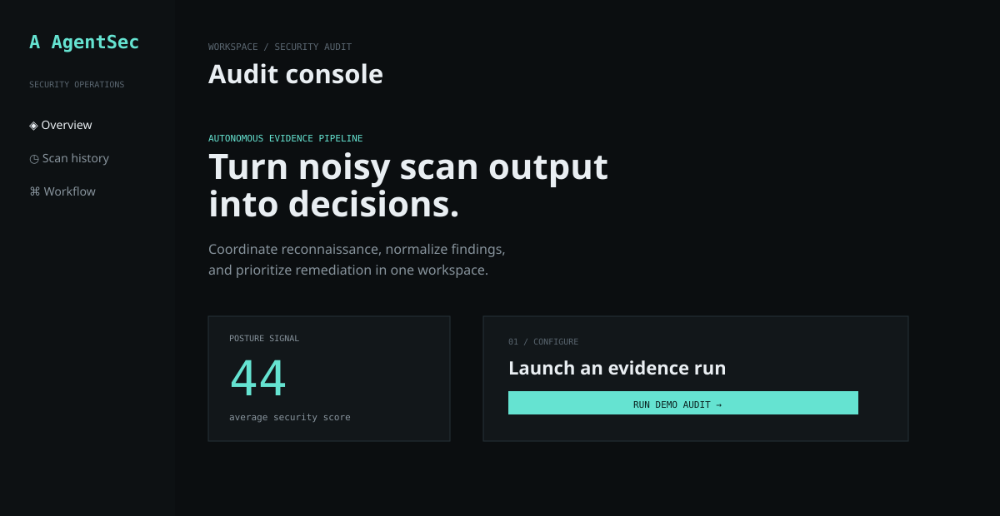
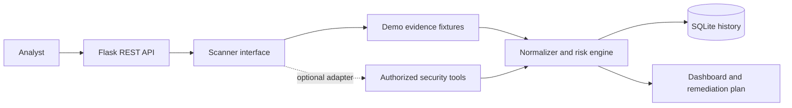

# AgentSec

> An analyst-ready security audit console that turns authorized scan evidence into prioritized decisions.

AgentSec is a portfolio implementation of an autonomous vulnerability-auditing workflow described in the accompanying academic specification. It demonstrates a complete security data path: request intake, evidence collection, normalization, risk scoring, persistence, and an explainable dashboard.



## Why this project matters

Security tools produce valuable evidence, but raw output is difficult to compare, prioritize, and communicate. AgentSec provides a thin orchestration and analysis layer around that evidence:

- **Orchestrate** a scan request through a Flask REST API.
- **Normalize** findings from multiple security-tool sources into one schema.
- **Score** the posture with deterministic severity penalties.
- **Persist** results and history in SQLite for repeatable investigation.
- **Explain** the result with evidence, impact, and a remediation plan.
- **Visualize** live progress and the latest assessment in a responsive console.

The included demo mode is deterministic and safe: it uses fixture evidence and never probes a target. Real tool adapters can be added behind the same scanner interface for an authorized Kali/Linux deployment.

## Run it in two minutes

```bash
python -m venv .venv
# Windows: .venv\\Scripts\\activate
# Linux/macOS: source .venv/bin/activate
pip install -r requirements.txt
python app.py
```

Open <http://localhost:3000>, enter a target label, and select **Run demo audit**. The demo completes in a few seconds and stores the result under `data/agentsec.db`.

### Docker

```bash
docker compose up --build
```

### Validate

```bash
pytest -q
```

## Architecture



## API surface

| Method | Endpoint | Purpose |
| --- | --- | --- |
| `GET` | `/api/health` | Service and operating mode check |
| `POST` | `/api/scans` | Start a demo audit with `target` and `ports` |
| `GET` | `/api/scans/<scan_id>` | Poll scan progress or retrieve a completed result |
| `GET` | `/api/history` | List recent completed audits |
| `GET` | `/api/stats` | Return aggregate posture metrics |

## Risk model

The score starts at 100 and applies a transparent penalty per validated finding: critical `45`, high `22`, medium `8`, and low `3`. Scores are clamped to 0-100 and mapped to `CRITICAL`, `HIGH`, `MEDIUM`, or `LOW`. False positives are excluded from the penalty calculation.

## Engineering notes

- The scanner is an interface boundary: demo fixtures are the default; production adapters can be injected without changing the API or dashboard.
- SQLite is intentionally local and inspectable for a portfolio demo. A production deployment would move persistence to a managed relational store and add authentication, authorization, rate limiting, and a job queue.
- The project never runs intrusive security commands by default. Only scan assets you own or have explicit permission to test.

## Project map

```text
app.py                 Flask routes and scan lifecycle
scanner.py             Demo adapter, scoring, and risk classification
database.py            SQLite persistence and aggregate queries
templates/index.html   Recruiter-facing dashboard
static/                Dashboard styles and polling client
tests/                 Focused scoring tests
Dockerfile             Reproducible container image
.github/workflows/     Automated test workflow
```

## Portfolio highlights

`Python` · `Flask` · `REST APIs` · `SQLite` · `Docker` · `GitHub Actions` · `security evidence normalization` · `risk scoring` · `responsive dashboards` · `responsible security testing`
